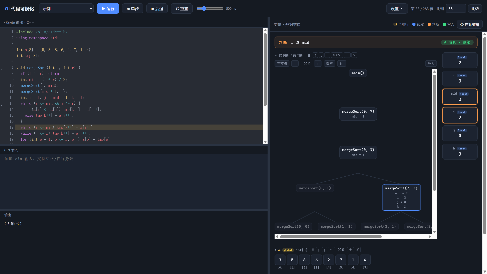
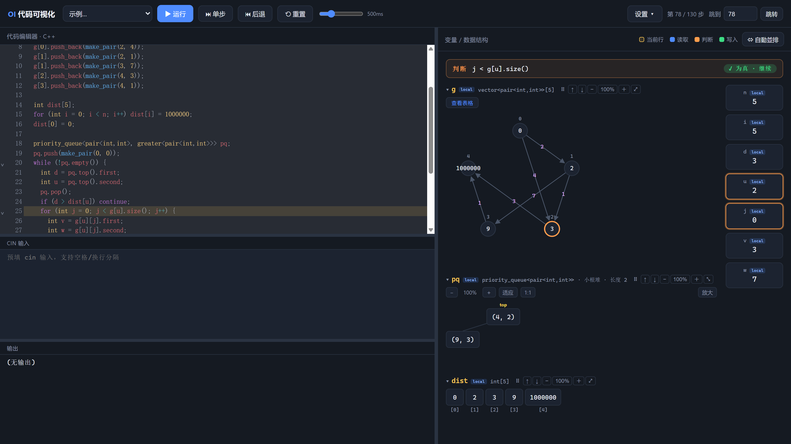

# cpp-viz — 浏览器里的 C++ 逐步可视化执行器

> 给一段 C++，它**逐语句执行**并画出每一步的内存状态：变量、数组、容器、树、图、递归调用树。
> 当前行高亮，读 = 蓝 / 写 = 绿 / 判断 = 橙，可前进、后退、跳步、断点。
> **纯前端、零后端**：一个静态站点（866 KB，gzip 271 KB），也可以内联成**单个 HTML 文件**离线跑。

**English.** cpp-viz is a browser-based C++ stepping visualiser I built from scratch. It ships a hand-written lexer → parser → AST, plus a generator-based interpreter that yields one immutable `Snapshot` per statement; the React UI is just a player that replays `snapshots[i]`. That design makes stepping *backwards*, jumping to step N, and breakpoints free — nothing is re-executed. No compiler, no debugger, no server: 31 source files / ~8k lines of TypeScript, 36 test files, 22 built-in examples.





---

## 为什么写它

最初是为了把「程序到底怎么跑」讲清楚——`a[mid] = x` 之后哪个格子变了、递归到第几层、堆里现在有什么，光靠讲义和口述很难让学生建立直觉。

后来它变成了我练习**工程能力**的载体：一个有真实复杂度的中型 TypeScript 项目，有自己的解释器、内存模型、测试体系和可回滚的重构历史，而不是一个 demo。

## 四个值得聊的技术点

1. **执行模型是「快照 + 回放」，不是「单步调试」**
   `run(program)` 是一个 generator：每个语句/判断前 `yield` 一份 `Snapshot`（变量树 + 读写标记 + 调用树 + 输出）。UI 只负责渲染 `snapshots[index]`。
   → 因此后退、跳步、断点在**不重跑程序**的前提下就能实现；也天然支持「停在某一步反复讲」。

2. **内存模型：递归不可变 Cell + 写时复制**
   一次写入只复制受影响的路径，其余节点共享。→ 大数组跑几千步也不会把内存打爆，同时每一步都能拿到完整的历史状态。

3. **为什么不用 GDB / 编译器插桩**
   教学需要的是「可回放 + 可视化 + 能指着某一格说话」，而不是真实进程的断点。自己写解释器换来的是：任意跳步、精确的读写归因、递归树可视化、完全离线。代价是只支持 C++ 的教学子集——**不支持的写法一律明确报错，绝不静默给出错误答案**（这是项目的第 0 号原则）。

4. **用测试接住重构**
   `interp-golden-test` 把 31 个代表性程序的每一帧状态摘要成 digest 当 golden file：纯重构 digest 不许变，行为一变立刻红灯。靠它把 `interpreter.ts` 从 2930 行拆到 113 行、把 `tsc` 从 31 个类型错误清到 0，而语义零回归。

## 功能一览

**执行与交互**：运行 / 暂停 / 单步 / 后退 / 跳到第 N 步 / 速度滑条；行号断点；快捷键（空格、←/→、R）；cin 输入预填；22 个内置示例；草稿自动保存。

**右侧数据面板**
- 当前行高亮；读 = 蓝、写 = 绿、判断 = 橙；判读横幅（「判断 i ≤ mid ✓ 为真 · 继续」）
- 数组（1D 滑动窗口 / 2D 固定 5×5 + 写入自动跳转）、vector（含多维 / 邻接表）、stack、queue、deque、priority_queue（堆树）、tree、bst、set、map、struct、pair
- 邻接表自动识别成**图**（带权边、箭头、节点值覆盖），图过大自动降级为表格
- **递归树**：节点高亮、返回后变暗并显示返回值、「调用栈」模式、可缩放
- 卡片可拖动排序 / 单卡缩放 / 整行宽 / **⇔ 自动并排**，布局记在 localStorage
- global / local 作用域标签；引用参数与数组形参标「别名」；排序时显示比较次数

## 快速开始

```bash
npm install
npm run dev          # http://localhost:5173
```

```bash
npm run build                    # 产出 dist/（默认根路径）
npm run build -- --base=./       # 相对路径，可放任意子目录 / GitHub Pages 项目页
```

- Windows 可直接双击 `start.bat`（自动检查 Node、首次自动装依赖）。
- 想要**双击即用、无需服务器**的版本：把 `dist/index.html` 里的 css/js 内联成单个 HTML（本仓库的发布包里已提供 `cpp-viz-单文件版.html`）。

## 架构

```
src/interpreter/   lexer → parser → ast
                   core（求值/语句/调用，三者互相递归必须同文件）
                   memory（递归不可变 Cell + 写时复制）
                   values / cells / builtins / input / snapshot / runtime
                   interpreter.ts（只剩 run() + 公开类型）
src/components/    CodeEditor、VariablesPanel（面板壳）
                   viz/（window / containers / graph / tree / format）
                   usePlayer（播放器状态机）、Topbar、Splitter、OutputPane、ErrorBoundary
src/App.tsx        主壳：版面 + 接线 + 全局快捷键 +「⇔ 自动并排」
src/presets.ts     22 个内置示例
test/              36 个测试文件（语义 / 渲染 / 布局 / golden / 兼容矩阵）
```

依赖方向：`components → interpreter`，解释器不 import React，可单独在 Node 里跑（测试就是这么做的）。

细节见 **[docs/ARCHITECTURE.md](docs/ARCHITECTURE.md)**。

## 工程指标

| 项 | 数值 |
|---|---|
| 源码规模 | 31 个文件 / 约 8,000 行 TypeScript（解释器 + 渲染层） |
| 测试 | 36 个测试文件 / 2,573 行；golden 特性化 + SSR 渲染 + 布局纯函数 + 兼容矩阵 |
| 产物 | 866 KB JS（gzip 271 KB）+ 19 KB CSS；无后端、无运行时服务 |
| 依赖 | React 19 + CodeMirror 6（无编辑器外的大型框架） |
| 内置示例 | 22 个 |
| 语言子集 | 7 种标量类型 + 16 种容器/结构 + 常用 STL 函数与输入输出 |

## 测试与验证

```bash
npm run typecheck   # tsc --noEmit（0 错误）
npm test            # 36 个测试文件
npm run verify      # typecheck + test + build（提交前必跑）
```

- `interp-golden-test`：31 个程序逐帧 digest 的 golden file，重构安全网；
- `compat-test` / `gap-test`：语言子集「可用 / 不可用」矩阵，每条都要求明确报错而不是静默错答；
- `render-test` / `render-limit-test`：`react-dom/server` 把面板渲染成 HTML，逐 preset 断言不崩、规模超限不卡死；
- `panellayout-test` / `appshell-test`：布局纯函数 + 整个 `<App/>` 的 SSR 烟雾测试。

## 已知限制

1. **只支持教学子集**：位运算、指针、类、模板、迭代器遍历、`printf`、`switch`、lambda、函数重载都不做；不支持的写法会**明确报错**。
2. `long long` 用 JS number 存，安全范围约 ±2^53，超出会失真（目前没有警告）。
3. 步数上限 20000；图 > 80 节点改表格；长容器只列前 300 项。
4. 局部数组声明后预设全 0（真实 C++ 是未定义值）。
5. 没有深浅色主题切换、没有导出图片/分享链接，UI 目前只有简体中文。

完整的语言子集与每条报错见 **[docs/LANGUAGE-SUBSET.md](docs/LANGUAGE-SUBSET.md)**；工程债与下一步见 **[docs/AI-HANDOFF.md](docs/AI-HANDOFF.md)**。

## 文档

| 文件 | 内容 |
|---|---|
| [docs/PROJECT-ONE-PAGER.md](docs/PROJECT-ONE-PAGER.md) | 一页纸项目介绍（中英双语，可直接用于简历/面试） |
| [docs/LANGUAGE-SUBSET.md](docs/LANGUAGE-SUBSET.md) | 语言子集完整参考：支持 / 不支持 / 会明确报错的每一种情况 |
| [docs/ARCHITECTURE.md](docs/ARCHITECTURE.md) | 模块地图、依赖方向、重构记录与计划 |
| [docs/AI-HANDOFF.md](docs/AI-HANDOFF.md) | 交接总纲：现状、约定、验证手册、已知不足、下一步 |
| [docs/HANDOFF.md](docs/HANDOFF.md) | 开发日志（逐版本） |
| [docs/DEBUG.md](docs/DEBUG.md) | 疑难档案（现象 / 根因 / 试过什么） |

## 授权

MIT License，见 [LICENSE](LICENSE)。示例代码可自由用于课堂与教学材料。
